# Base de datos del CMS (PostgreSQL 15+, probada en 18)

Esquema `app`: 14 migraciones SQL puras en `migrations/` (se aplican en orden numérico), 55 tablas. Reemplaza lo que hoy vive en
Antes vivía en `.cms-data`, `.cache` y el `localStorage` del navegador; ya solo queda `localStorage` (preferencias de cada persona).

> **Estado de la conexión:** el esquema está terminado y probado. La app ya usa la base de datos para **inicio de sesión, usuarios, accesos (con alcance por
> páginas y secciones), cambio y restablecimiento de contraseña (fase 1) y el SITIO: páginas, secciones, componentes, animaciones, estilos, funciones, APIs,
> librerías y comentarios, con el código guardado como árboles (fase 2)**. Lo demás (versiones y pull requests, publicar/desplegar, medios en ImageKit,
> preferencias, caché de APIs, tiempo real) sigue en `.cms-data`, `.cache` y `localStorage` hasta su fase: ver «Conectar la app» al final.
>
> Primeros pasos (completos en el README de la raíz): copiar `.env.example` a `.env.local` → `pnpm db:up` → `pnpm db:setup` (migraciones, usuario de la app, organización y tres cuentas de prueba) → `pnpm dev`. Se entra con el **correo**.
> Pruebas: `scripts/e2e-auth.sh` (usuarios) y `node --env-file=.env.local scripts/e2e-site.mts` (sitio), con `pnpm dev` y la base de datos arriba.

```
migrations/
  0001_foundation     ids UUIDv7, app.current_org(), triggers base, roles de base de datos
  0002_tenancy        organizaciones, usuarios, preferencias, reset de contraseña, proyectos, contadores, membresías
  0003_site_content   páginas, secciones, componentes, animaciones, medios, estilos, funciones, librerías, comentarios, alcance
  0004_data_sources   APIs de la pestaña Datos y su caché
  0005_versioning     fotos, ramas con dueño, versiones con padres, pull requests, issues
  0006_publishing     publicaciones inmutables, dominios, destinos y ejecuciones de despliegue
  0007_audit          auditoría particionada por mes
  0008_integrity      row_version, inmutabilidad, rama main + creador, cuota de proyectos
  0009_security       RLS (organización, membresía, pull requests, preferencias), funciones de acceso transversal, permisos
  0010_permissions    matriz de permisos, ajustes por organización, guardas que los hacen cumplir en la base
  0011_media          cuota de almacenamiento, qué publicación usa qué archivo, limpieza de ImageKit
  0012_code_units     el código del usuario como AST (nunca texto)
  0013_collaboration  invitaciones, enlaces para compartir, registro de operaciones en tiempo real
  0014_workflow       ramas y pull requests como GitHub, numeración, mantenimiento
tests/
  isolation.sql       aislamiento entre organizaciones e integridad (43 comprobaciones)
  collaboration.sql   permisos, compartir, versiones, flujo GitHub, código AST, medios, tiempo real, auditoría del CMS (130)
  load-bench.sql      siembra 150 000 bloques y mide las rutas críticas (solo en base desechable)
```

```bash
POSTGRES_PASSWORD=dev docker compose -f db/docker-compose.yml up -d        # POSTGRES_PORT=… si 5432 está ocupado
docker compose -f db/docker-compose.yml exec -T postgres psql -U postgres -d portal -v ON_ERROR_STOP=1 < db/tests/isolation.sql
docker compose -f db/docker-compose.yml exec -T postgres psql -U postgres -d portal -v ON_ERROR_STOP=1 < db/tests/collaboration.sql
```

## Cardinalidades

```mermaid
erDiagram
  organizations ||--|| organization_settings : "reglas de trabajo"
  organizations ||--o{ organization_role_permissions : "excepciones a la matriz"
  organizations ||--|| organization_usage : "almacenamiento usado"
  organizations ||--o{ users : "1 usuario = 1 organización"
  organizations ||--o{ projects : ""
  users |o--o{ users : "invited_by"
  users ||--o{ password_reset_tokens : ""
  users ||--o{ user_preferences : "atajos, panel, modo avanzado"
  projects ||--|| project_counters : "números #12"
  projects ||--o{ project_members : ""
  users ||--o{ project_members : "trabaja en"
  project_members ||--o{ member_scope_pages : "alcance"
  project_members ||--o{ member_scope_blocks : "alcance"
  projects ||--o{ invitations : ""
  projects ||--o{ share_links : ""
  projects ||--o{ pages : ""
  projects ||--o{ components : ""
  pages ||--o{ blocks : ""
  components |o--o{ blocks : "o built_in_key"
  pages ||--o{ media_items : ""
  pages ||--o{ animations : ""
  animations ||--o{ animation_steps : ""
  blocks ||--o{ animation_steps : "anima a"
  projects ||--o{ assets : "ImageKit"
  assets |o--o{ media_items : ""
  pages ||--o{ design_comments : ""
  projects ||--o{ style_variables : "ámbito"
  projects ||--o{ style_rules : "ámbito"
  projects ||--o{ shared_functions : ""
  blocks |o--o{ shared_functions : "alcance sección/elemento"
  projects ||--o{ data_sources : ""
  projects ||--o{ data_source_cache : ""
  projects ||--o{ project_libraries : ""
  projects ||--o{ code_units : "AST"
  pages |o--o{ code_units : "dueño"
  blocks |o--o{ code_units : "dueño"
  components |o--o{ code_units : "dueño"
  shared_functions |o--o{ code_units : "dueño"
  data_sources |o--o{ code_units : "dueño"
  projects ||--|{ branches : "al menos main"
  users |o--o{ branches : "dueño (main no tiene)"
  branches |o--o{ branches : "base"
  branches ||--o{ commits : ""
  site_snapshots ||--o{ commits : "foto completa"
  commits |o--o{ commits : "padre / segundo padre"
  commits ||--o{ commit_changes : "diff legible"
  branches ||--|| branch_sync : "contador"
  branches ||--o{ edit_operations : "tiempo real"
  projects ||--o{ pull_requests : ""
  pull_requests }o--o{ commits : "pull_request_commits"
  pull_requests }o--o{ users : "aprobaciones"
  pull_requests ||--o{ pull_request_conflicts : ""
  projects ||--o{ issues : ""
  issue_labels |o--o{ issues : ""
  issues }o--o{ users : "responsables"
  projects ||--o{ publications : "historial inmutable"
  projects |o--o| publications : "live_publication_id"
  publications }o--o{ assets : "publication_assets"
  projects ||--o{ project_domains : ""
  projects ||--o{ deploy_targets : ""
  publications ||--o{ deployments : ""
```



## Aislamiento: cuatro barreras independientes

| Barrera | Qué impide | Dónde |
|---|---|---|
| **FK compuestas** `(organization_id, project_id, id)` | Que una fila de la org A apunte a otra de la B, o a otro proyecto, aunque la API se equivoque. | todas las tablas hijas |
| **RLS por organización** | Leer o escribir filas de otra organización. Sin organización fijada no se ve nada. | `0009` |
| **RLS por membresía** | Ver un proyecto de tu organización del que no eres miembro o con el acceso vencido. Los superadmin ven todos los de su organización. | `app.visible_projects()` |
| **Rol sin privilegios** `portal_app` | Saltarse RLS (el dueño de las tablas sí la salta: la API **nunca** se conecta con él). | `0001`, `0009` |

Una persona pertenece a **una** organización (`users.organization_id NOT NULL`, sin tabla puente). No existe forma de dar acceso de edición a una cuenta de otra
organización: compartir es invitar *dentro* de la organización o dar un enlace de solo lectura.

### Patrón obligatorio de la API

```ts
await sql.begin(async (tx) => {
  await tx`select set_config('app.org_id',  ${session.orgId},  true)`;   // true = muere con la transacción (seguro con PgBouncer)
  await tx`select set_config('app.user_id', ${session.userId}, true)`;
  // …consultas: RLS y permisos ya aplican
});
```
Sin `app.user_id` la API no puede leer proyectos ni escribir nada (falla cerrado). Nunca uses `SET` de sesión. La cuenta de login de la API debe crearse con pertenencia
**directa** al rol de grupo (`CREATE ROLE portal_api LOGIN … IN ROLE portal_app`): así `app.is_system_session()` la distingue del dueño de las tablas, que sí salta permisos.

Cruzan organizaciones solo funciones `SECURITY DEFINER` con `search_path` fijo y salida mínima: `login_lookup`, `reset_password_with_token`, `resolve_public_site`,
`resolve_invitation`, `accept_invitation`, `resolve_share_link` y (solo `portal_platform`) `provision_organization`. *No* fijes `app.user_id` al llamar a las anónimas.

## Permisos

Un permiso se concede si coinciden **cuatro cosas** y ninguna lo veta (`app.has_permission(proyecto, permiso)`): **rol de la cuenta** (con las excepciones de su organización) ∩
**rol en el proyecto** − **vetos** (`project_members.denied`) − **acceso vencido**. Para editar contenido se exige además el **alcance** asignado. Los superadmin no se limitan.

| Permiso | superadmin | dev | designer | | Rol en el proyecto | puede |
|---|:-:|:-:|:-:|---|---|---|
| viewAll, comment | ✔ | ✔ | ✔ | | `viewer` | ver |
| editContent, invite, publishMain | ✔ | ✔ | ✔ | | `commenter` | ver y comentar |
| editStyles, editCode, editData, installLibraries, viewAudit, deploy | ✔ | ✔ | ✘ | | `reviewer` | + fusionar en main |
| manageUsers | ✔ | ✘ | ✘ | | `editor` | todo lo que su rol permita |

Quién puede dar qué rol al invitar (`role_grants`): superadmin→dev/designer · dev→dev/designer · designer→designer.
Las decisiones de permiso se recuerdan dentro de la transacción (y se invalidan solas si esa transacción cambia usuarios o membresías).
Limitación conocida: «nunca más permisos que quien te invitó» (`combineAccess`) lo calcula la API al conceder; si luego se reduce el acceso de quien invitó, la API debe propagarlo.

**El modelo de trabajo es por organización:** `organization_settings` (enlaces públicos sí/no, duración máxima, vigencia de invitaciones) y `organization_role_permissions` (la
organización le da o quita permisos a `dev`/`designer`). Solo su superadmin las cambia y no afectan a ninguna otra. Las cuotas las fija la plataforma.

## Flujo de trabajo como GitHub

- **Las tablas de contenido SON `main`.** Escribirlas (páginas, secciones, componentes, estilos, funciones, APIs, librerías, animaciones, código) exige `publishMain`, además del permiso
  propio de cada tabla. Las demás ramas no son filas: son una **foto + operaciones** que el editor carga.
- **Quien no puede publicar en main trabaja en SU rama.** `app.ensure_work_branch(proyecto)` devuelve `main` a los permitidos y, a los demás, crea (la primera vez) y reutiliza
  `trabajo-<usuario>` (mismo nombre que `defaultBranchOf`). Solo su dueño (o quien tenga `publishMain`) escribe en ella; nadie cambia el dueño de una rama.
- **Enviar = pull request.** `app.open_pull_request(rama, título)` es idempotente: la crea hacia main y la entrega a quien invitó al autor (o a un superadmin si nadie lo invitó),
  y cada versión nueva en esa rama se suma sola a la pull request abierta (como un push). Cada persona solo ve las que envió o le toca revisar.
- **Fusionar** (`app.merge_pull_request(pr, foto, mensaje)`) lo hace solo quien puede revisarla (nunca el autor) **y** tiene `publishMain`: exige conflictos resueltos y las aprobaciones
  pedidas, crea la versión de fusión en main con **dos padres** y cierra la pull request. El estado de una pull request no se puede saltar con un `UPDATE`.
- La API fusiona en UNA transacción: calcula el estado fusionado (3 vías sobre las fotos), lo guarda como foto, escribe esas filas en main y llama a `merge_pull_request`.

## Compartir
| Forma | Quién entra | Qué ve | Salvaguardas |
|---|---|---|---|
| **Invitación** | alguien con correo nuevo; se crea su cuenta *en esta organización* | lo que diga su membresía (rol, vetos, alcance, vencimiento) | un solo uso, vence, el correo no puede existir ya en la plataforma |
| **Enlace interno** (`organization`) | sesión iniciada en la **misma** organización | ver o comentar | la API compara organizaciones; si no coinciden, 404 |
| **Enlace público** (`anyone`) | cualquiera, sin cuenta | **solo lectura** de una publicación inmutable | siempre vence, nunca comenta, la organización puede prohibirlo |

## Versiones
Cada versión (`commits`) apunta a una **foto completa** (`site_snapshots`, direccionada por contenido) y a su **versión padre** (y a un **segundo padre** si es una fusión). La rama guarda su
**cabeza** y su **punto de bifurcación** (el ancestro común para fusionar).
- **Restaurar** = añadir una versión `restore` que reutiliza la foto antigua; la historia nunca se reescribe (versiones, fotos y publicaciones son inmutables).
- **Dos personas guardando a la vez**: la versión nueva debe nacer de la cabeza actual; si no, `serialization_failure (40001)` y el cliente reintenta sobre la cabeza nueva.
- `commit_changes` (nodo, propiedad, antes→después) es el diff legible que muestra la interfaz. Las fotos incluyen los AST: restaurar una versión restaura también su código.

## Código = objetos, nunca texto
`code_units`: cada unidad de código es una fila con su `ast jsonb`, `parser` y `parser_version`; pertenece a exactamente un dueño (página, sección, componente, función, API o el proyecto) y a una
ranura con nombre (`js`, `css`, `body`, `transform`, `behavior.<id>.js`…); muere con su dueño. Ya no hay `pages.css/js`, `projects.global_css`, `shared_functions.code` ni `data_sources.transform`;
una prueba verifica que **no existe ninguna columna de código en texto**.

La base solo garantiza la **forma**. Quien parsea y genera es la API/el editor. Lo verifiqué con los analizadores reales (`@babel/parser` 7.29, `css-tree` 3.2, `parse5` 7.3) y esto es lo que hay que hacer:

| Lenguaje | Guardar (texto → árbol) | Abrir en Monaco (árbol → texto) | Notas verificadas |
|---|---|---|---|
| TS / JS | `parse(src, { sourceType: 'module', plugins: ['typescript'] })`, quitar `start/end/loc/range` en todo el árbol | `@babel/generator` | ciclo estable (reparsear lo impreso da el mismo árbol); conserva los comentarios; 167 B de código → 1,9 KB de árbol |
| CSS | `csstree.toPlainObject(csstree.parse(css, { positions: false }))` | `csstree.generate(csstree.fromPlainObject(ast))` | imprime minificado |
| HTML | `parse5.parseFragment(html)` (o `parse` si es un documento) | `parse5.serialize` | la raíz es `#document-fragment` o `#document`; **parse5 enlaza cada nodo con su padre (`parentNode`), así que `JSON.stringify` falla**: hay que quitar ese enlace al guardar y restaurarlo (recorrido de una pasada) al leer |

Antes de guardar, la API **recorre el árbol y lo valida contra una lista blanca** (probado con `@babel/traverse`: detecta `eval`, `new Function`, `document.cookie`, `import()` y `fetch` a hosts no permitidos).
Hay que saber que: al reimprimir se **normaliza el formato** (se conservan los comentarios, no los espacios); el sitio **publicado sí contiene JavaScript generado** (el navegador del visitante ejecuta texto: es un
artefacto derivado e inmutable, nunca la fuente editable); y el formato de un árbol cambia entre versiones del analizador, por eso se guarda `parser_version` (migrar = reimprimir con el viejo y reparsear con el nuevo).
**Nada de esto está construido todavía**: el editor sigue usando Sucrase y texto. Hay que instalar `@babel/parser`, `@babel/generator`, `@babel/traverse`, `css-tree` y `parse5`.

## Medios (ImageKit)
`assets` es la biblioteca de medios del proyecto (la de «estilo Canva»: nombre, etiquetas, tamaño, medidas). ImageKit guarda el original y entrega cualquier tamaño o formato **por URL** (`?tr=w-640,f-auto`),
así que no hay tabla de miniaturas. Flujo: la API crea la ficha `pending` (reserva cuota) y firma los parámetros de subida → el navegador sube **directo a ImageKit** → la API consulta el archivo,
verifica el tamaño y guarda su `imagekit_file_id` → `ready`.
- La ruta debe empezar por `/org/<organización>/` (CHECK): la ficha no puede apuntar a la carpeta de otra. La URL pública no se guarda (es el *URL endpoint* + la ruta).
- Se pregunta por el hash *antes* de subir (sin duplicados). Tipos en lista cerrada (SVG: sanear al subir). **Cuota** por organización con un contador movido solo por disparadores.
- `publication_assets`: una publicación (o una a la que se pueda volver) **impide borrar** un archivo que usa. En los elementos, referencia el archivo como `asset:<id>`, no como URL.
- Limpieza: `app.find_orphan_assets()` (trabajo de plataforma) devuelve subidas sin terminar y archivos sin uso con su `imagekit_file_id`; la plataforma los borra en ImageKit y luego las filas.
- Falta el exportado estático para destinos FTP/cPanel: debe descargar los archivos de ImageKit a la carpeta del sitio.

## Tiempo real
El cliente envía **acciones del reducer** (`SiteAction`); `app.append_operations(rama, cliente, acciones)` reserva un rango contiguo de secuencias y las guarda en una ida y vuelta. Quien se conecta tarde pide
«todo desde la seq N». `app.compact_operations` archiva lo ya incluido en una versión. **Presencia, cursores y selección NO van a Postgres** (cambian varias veces por segundo): memoria/Redis. Difunde por Redis
**después del commit**; no uses `LISTEN/NOTIFY` (serializa los commits con un bloqueo global).

## Qué guarda el CMS y dónde (auditado contra el código)

| Función del CMS | Dónde queda |
|---|---|
| Páginas, SEO, tipo de página (carga / 404 / esqueleto), rutas dinámicas, ocultar encabezado/pie | `pages` (+ `settings`) |
| Secciones, orden, ocultar, **bloquear**, encabezado/cuerpo/pie, global/página | `blocks` (columnas `position`, `hidden`, `locked`, `slot`, `scope`) |
| Formato propio de la sección, **responsive** (tablet/móvil, adaptar, menú, plegar), interacciones, enlaces a datos, repetición y paginación | `blocks.format` |
| Componentes propios, elementos, capas (nombre, bloqueo), formularios (`control`), enlaces entre páginas | `components.elements/links` |
| **Animaciones grabadas** y sus pasos | `animations` + `animation_steps` (el paso cae con su sección) |
| **Duplicar, copiar y pegar, mover, agrupar, ordenar, unir** | son acciones del reducer: su efecto son filas nuevas/cambiadas (ids nuevos, `position`, `page_id`) y operaciones en `edit_operations`. Al duplicar o pegar una sección, la API también copia sus `code_units`, animaciones y funciones. El portapapeles en sí no se guarda |
| Variables y reglas de estilo, CSS global/de página/de sección | `style_variables`, `style_rules`, `code_units` (CSS como árbol) |
| Funciones reutilizables (alcance global/sección/elemento) | `shared_functions` + `code_units` |
| APIs de la pestaña Datos, caché de respuestas | `data_sources`, `data_source_cache` (claves cifradas por la API) |
| Librerías del proyecto | `project_libraries` |
| Comentarios del equipo | `design_comments` |
| Medios del proyecto y de cada página | `assets` (ImageKit), `media_items` |
| Versiones, ramas, pull requests, issues | `branches`, `commits`, `site_snapshots`, `pull_requests`…, `issues` |
| Publicar, dominios, desplegar (Vercel/FTP/SFTP/cPanel) | `publications`, `project_domains`, `deploy_targets` (secretos cifrados), `deployments` |
| Usuarios, roles, invitaciones, acceso limitado, restablecer contraseña | `users`, `project_members`, `invitations`, `member_scope_*`, `password_reset_tokens` |
| **Atajos de teclado, panel del inspector, modo avanzado** (hoy `localStorage`) | `user_preferences` |
| Resultados de auditoría (Lighthouse) | no se guardan: se calculan al momento |
| Datos de formularios enviados por los visitantes | **no se guardan**: se envían a la URL que elija el usuario. Si se quiere una bandeja de entrada en el CMS, es una función nueva |

## Rendimiento medido
Datos: 50 organizaciones, 250 proyectos, 5 000 páginas, **150 000 bloques**. Rol `portal_app` con RLS y guardas activas, usuario **desarrollador no superadmin** (el peor caso). Postgres 18 en un contenedor de
4 vCPU compartidas y 1,8 GB de RAM sobre Windows.

| Operación | Sin permisos (referencia) | Con permisos, en caliente |
|---|---|---|
| Abrir el editor: 600 bloques de un proyecto (~500 KB) | 16 ms | 75–90 ms |
| Abrir el editor: páginas | 0,3 ms | ~1 ms |
| Guardar una página (30 bloques, una sentencia) | 13 ms | 64–74 ms (la guarda aporta ~8 ms) |
| Iniciar sesión (`login_lookup`) | 4 ms | 2–3 ms |
| Sitio público por dominio | 13 ms | 5–19 ms |

Son cifras de la base de datos en una máquina pequeña y ruidosa (la primera pasada llegó a multiplicarse por 3–10), no de producción; la guarda de permisos de contenido cuesta ~0,25 ms por fila. Se midieron **antes**
de añadir ImageKit, las ramas por dueño y las pull requests; esas reglas no tocan las rutas medidas. Falta medir en el hardware real y con la red y la API en medio.

## Conectar la app (pendiente — nada de esto está hecho)
Hoy el CMS escribe en disco y en el navegador. Para que **todo** viva en la base de datos hay que reemplazar:

| Hoy | Pasa a | Trabajo |
|---|---|---|
| ✔ `.cms-data/users.json`, `auth-*.ts` | `users`, `project_members`, `login_lookup` | **hecho (fase 1).** Login por correo; las contraseñas existentes se conservan (`scripts/db-seed.mts` las importa). Alcance por páginas/secciones: sin asignar hasta la fase del sitio |
| ✔ `.cms-data/password-resets.json` | `password_reset_tokens`, `reset_password_with_token` | **hecho (fase 1).** El límite de intentos sigue en memoria (a Redis con varias instancias) |
| ✔ `.cms-data/project-site.json` + `useAutosave` (todo el sitio en un JSON) | `pages`, `blocks`, `components`, `code_units`… | **hecho (fase 2).** `app/server/site/` traduce el estado a filas y árboles; el editor (`use-site-sync`) envía solo lo que cambió. Los ids son los del editor (texto), únicos por proyecto. El código con errores de sintaxis no se guarda (se conserva la última versión válida y se avisa) |
| `.cms-data/project-versions.json`, `reviews.json` | `branches`, `commits`, `site_snapshots`, `pull_requests` | el prototipo en memoria se vuelve real |
| `.cms-data/published-site.json` | `publications` | |
| `.cms-data/deploy-targets.json` | `deploy_targets` | cifrar secretos (AES-256-GCM, clave en el servidor) |
| `.cache/data-sources` | `data_source_cache` | |
| `portal-libraries.json` + instalación con `pnpm` en el disco del servidor | `project_libraries` | las librerías `pnpm` se instalan en disco compartido (no es multi-organización ni sin disco): usar solo CDN o subir el bundle a ImageKit |
| `localStorage` (atajos, inspector, modo avanzado) | `user_preferences` | |
| Sucrase + texto | `@babel/*`, `css-tree`, `parse5` + `code_units` | validación con lista blanca |
| Imágenes locales / URLs | ImageKit | claves de ImageKit (pública y privada) y subida directa |
| — | tiempo real | servidor WebSocket + Redis para presencia y difusión |
| ids de texto (`demo-…`) | UUID | `crypto.randomUUID()` en el cliente |

Operación: PgBouncer (modo transacción), PITR con `pg_basebackup` + WAL, trabajos diarios (`ensure_audit_partitions`, `find_orphan_assets`, `compact_operations`, `purge_expired`).


## Ramas en la práctica (fase 3, 0015)
- Estado de una rama que no es main = foto de su última versión + ediciones (`edit_operations`, acción `{type:"patch", patch}`) posteriores a `commits.ops_through`. Las ediciones llevan el código como texto hasta que se guarda una versión (la foto sí lo guarda como árbol); se comprueban con `has_permission`/`can_edit_content` en `patch-permissions.ts`.
- Una versión guarda TODO el estado de la rama (no hay selección de cambios); `commit_changes` es el resumen legible que calcula el editor.
- Fusionar: 3 vías por id (`site-merge.ts`); con conflictos sin resolver responde 409 con la lista y no escribe nada. Solo se fusiona en main.
- Main sin versión: la primera persona con `publishMain` que abre el editor crea "Versión inicial". El historial es inmutable (ya no existe «borrar historial»).
- Pruebas: `node --env-file=.env.local scripts/e2e-versions.mts` (31).

## Sin archivos JSON (fases 3b, 0016 y 0017)
Ya no se guarda nada en `.cms-data` ni `.cache`: todo vive en la base de datos.
- **Publicar**: `POST /api/cms/publish` pone la última versión de una rama como `publications` (foto inmutable) y la deja en `projects.live_publication_id`. El público lee `/api/site` sin sesión: dominio verificado → `resolve_public_site`; si no hay dominio, la organización de `PORTAL_ORG_SLUG` → `resolve_public_site_by_org`. El paquete exportado (ZIP/Docker) no lleva base: su contenido viaja en `published-site.json`, que solo lee un servidor sin `DATABASE_URL`.
- **Despliegue**: la cuenta (servidor, usuario, token) en `organization_integrations` (solo su superadministrador) y el destino (carpeta, nombre del proyecto) en `deploy_targets`; cada ejecución queda en `deployments` y despliega la publicación en línea.
- **Caché de APIs**: `data_source_cache` por `app.cache_get/cache_put` (el proxy atiende a visitantes sin sesión).
- **Librerías pnpm**: lista por organización en `organization_packages`; el paquete solo se borra del disco si ninguna otra organización lo tiene.
- Issues, etiquetas y publicaciones vienen en la misma respuesta que ramas y versiones. El equipo de ejemplo del botón «Compartir» se eliminó: se comparte con cuentas reales (Usuarios / accesos).
- `pnpm db:seed` ya no importa archivos: crea la organización, el proyecto y tres cuentas de prueba.

## Crear la base en tu Postgres (un comando)
1. Crea la base vacía: `createdb portal` (o `docker exec … createdb`). 2. Copia `.env.example` a `.env.local` y pon tus datos en `DATABASE_ADMIN_URL` (dueño) y `DATABASE_URL` (usuario de la app, se crea solo). 3. **`pnpm db:setup`**: aplica las migraciones que falten, crea el usuario de la app y carga la organización con tres cuentas de prueba. Se puede repetir sin problema. Con Docker: `pnpm db:up` y luego `pnpm db:setup`.
Lo único que la app guarda en el navegador es si el explorador (menú izquierdo) está recogido; atajos, inspector y modo avanzado van a `user_preferences`.

## Tiempo real (WebSockets)
`realtime/server.mts` (puerto `REALTIME_PORT`, 3001) lo arranca `pnpm dev`/`pnpm start` junto a la app (`scripts/run.mjs`). Entra con un boleto de un minuto firmado con `AUTH_SECRET` que entrega `/api/cms/realtime` (con él sabe quién eres y si puedes editar); no usa la base ni cookies. Retransmite en memoria, por proyecto: presencia («En vivo» con avatares junto a Compartir), cursor sobre cada página (en píxeles del diseño), selección (marco con nombre y «moviendo») y los borradores de edición de quienes están en la MISMA rama. Guardar sigue siendo cosa de cada persona por la API (con sus permisos): quien recibe un borrador nunca lo guarda. Si se cae la conexión se reconecta sola y recarga la rama. Con `REDIS_URL` pueden correr VARIAS instancias (`realtime/bus.mts`): lo que pasa en una sala llega por Redis a las personas de cualquier instancia, quien entra ve a quienes ya estaban en otras (`rt:peers:<sala>`), y las personas de una instancia caída dejan de contar al caducar su latido (45 s) o al apagarse con SIGTERM. Redis local: `docker compose --profile cluster up -d redis`. Prueba: `REDIS_URL=… node --env-file=.env.local scripts/e2e-realtime-cluster.mts` (13; levanta tres instancias propias). En producción detrás de un proxy: `REALTIME_URL=wss://…`. Prueba: `node --env-file=.env.local scripts/e2e-realtime.mts` (12).

## Servidores de despliegue
Cada tipo es un `Deployer` (`app/server/deployers/`, una línea en `index.ts`): `test` comprueba la conexión sin subir nada y `deploy` sube. **Vercel** construye la aplicación; **FTP** (`basic-ftp`, FTPS con «si»), **SFTP** (`ssh2-sftp-client`, usuario y contraseña) y **cPanel** (API con token, puerto 2083) suben el mismo paquete que el ZIP, con el sitio publicado dentro (para VPS o la «aplicación Node.js» de cPanel; no sirve para alojamientos solo de archivos estáticos). La cuenta (servidor, usuario, clave) es de la organización (`organization_integrations`, solo su superadministrador) y la carpeta es del proyecto (`deploy_targets`); cada ejecución queda en `deployments`. FTP y SFTP se probaron contra servidores reales en Docker; cPanel se prueba con respuestas simuladas (no se probó contra un cPanel real).

## Imágenes y videos (ImageKit)
`POST /api/cms/assets` recibe el archivo, comprueba su tipo REAL por los primeros bytes (PNG, JPG, WebP, AVIF, GIF, MP4, WebM; sin SVG; imágenes ≤ 10 MB, videos ≤ 50 MB), reserva la ficha en `assets` (cobra la cuota; el mismo contenido en el mismo proyecto no se sube dos veces), lo sube a ImageKit con la clave privada del servidor (`/org/<organización>/<proyecto>/<huella>-nombre`) y devuelve la dirección pública, que es lo que se guarda en el diseño. Si la subida falla la ficha se borra y la cuota vuelve. Variables: `IMAGEKIT_PUBLIC_KEY`, `IMAGEKIT_PRIVATE_KEY`, `IMAGEKIT_URL_ENDPOINT`. `app.find_orphan_assets()` (0018) considera en uso un archivo si su ruta aparece en el contenido de hoy, en alguna versión o en una publicación; la limpieza (borrar en ImageKit con `deleteFromImageKit` y luego las filas) aún no está programada. Prueba: `node --env-file=.env.local scripts/e2e-media.mts` (9, sube y borra un archivo mínimo de verdad).

## Mantenimiento programado
`pnpm maintenance` (`scripts/maintenance.mts`, con DATABASE_ADMIN_URL) borra de ImageKit y de la base los archivos que ya nadie usa (ni el diseño, ni una versión, ni una publicación; 7 días de gracia) y las subidas cortadas, y limpia la caché de APIs vencida y los enlaces de contraseña viejos (`app.purge_expired`). `--dry` solo dice qué sobraría. Si ImageKit no responde, la ficha se queda y se reintenta. `RUN_MAINTENANCE=1 pnpm start` lo repite cada 24 h junto a la app; también sirve una tarea programada del sistema que ejecute `pnpm maintenance`.
Entrega optimizada: las imágenes PNG/JPG/WebP de ImageKit se muestran con `?tr=f-auto,q-auto` (`optimizedSrc`); el diseño guarda la dirección original.

## Cuota de almacenamiento
`GET /api/cms/assets` devuelve cuánto ocupa la organización (`organization_usage`, que solo mueven los disparadores) frente a su plan (`organizations.max_storage_bytes`, 5 GB por defecto), cuántos archivos tiene y si ImageKit está configurado. El panel de medios lo muestra con una barra (ámbar desde el 80 %, roja desde el 95 %) que se actualiza sola al subir. Con el plan lleno, subir responde 409 «La organización alcanzó su cuota de almacenamiento» y no deja nada a medias. Ampliar el plan es cambiar `max_storage_bytes` de la organización.
