# Análisis funcional del CMS

**Revisión del código:** 27 de noviembre de 2026  
**Alcance:** recorrido estático de la aplicación, el guardado del sitio, la base de datos, las ramas/versiones, la publicación y la entrega pública. No se ejecutaron pruebas ni se modificó código de la aplicación.

Esta guía explica cómo se conectan las piezas en el estado actual del repositorio. Está escrita para entender el comportamiento y estimar el impacto de cambios, no como una especificación exhaustiva de cada herramienta del editor.

## 1. Idea general

El CMS trabaja con un **modelo de sitio en memoria** llamado `SiteState`. El editor modifica ese modelo; el servidor recibe diferencias pequeñas, las valida y las convierte en registros de PostgreSQL. El visitante no recibe el borrador del editor: recibe una **foto inmutable de una versión publicada**.

```mermaid
flowchart LR
  UI[Editor visual] -->|acciones| Reducer[SiteState + reducer]
  Reducer -->|diff después de 800 ms| Sync[use-site-sync]
  Sync -->|GET / PUT| API[API CMS]
  API -->|sesión, permisos y alcance| Guard[versionRoute + inProject + RLS]
  Guard -->|main: tablas / otras ramas: operaciones| DB[(PostgreSQL)]
  DB -->|guardar versión| Commit[commit + snapshot]
  Commit -->|publicar versión| Pub[publicación inmutable]
  Pub -->|GET /api/site| Visitor[Portal público]
```

Cada flecha tiene un propósito distinto: **editar** cambia el borrador, **guardar** persiste el borrador de la rama, **guardar versión** crea un punto de recuperación y **publicar** cambia qué fotografía ve el público.

## 2. Cómo arranca el CMS y cómo se muestra el portal

1. `app/page.tsx` monta `HomeClient`. Si el paquete está en modo de sitio desplegado (`CMS_MODE=site`), la ruta raíz redirige a `/ver`.
2. `HomeClient` monta `AuthProvider`. Este consulta `/api/auth/me`, mantiene el usuario actual en contexto y lo vuelve a comprobar cada minuto mientras haya sesión.
3. `AppShell` muestra carga, login o editor según el estado de autenticación. El editor requiere sesión.
4. Con sesión, `CmsProviders` conecta los contextos: rama, sitio, medios, versionado, viewport, tiempo real, navegación, workbench y comandos. `EditorWorkspace` presenta barra superior, panel de herramientas, lienzo e inspector.
5. `CanvasPages` presenta páginas del `SiteState`; cada página coloca sus secciones y medios. En modo de edición añade selección, herramientas y controles. En vista previa desactiva la edición.
6. `/ver` monta `SiteViewer`, que solicita `/api/site`. La ruta pública lee el dominio recibido y encuentra la publicación activa; si no hay dominio configurado usa el slug de organización. El visor recibe ese snapshot y monta los proveedores sin persistencia ni edición.

Por eso una modificación que se ve en el editor todavía puede no aparecer en `/ver`: primero debe quedar guardada en una rama, tener una versión y luego publicarse.

## 3. Modelo: página, sección, componente y elemento

El estado lógico principal está tipado en `app/components/site/types.ts`.

| Objeto | Qué representa | Relación principal |
|---|---|---|
| Proyecto / `SiteState` | Sitio completo y configuración global | Contiene páginas, componentes, navegación, reglas y variables |
| `Page` | Ruta o pantalla del sitio | Contiene `blocks` (secciones) y medios de página |
| `BlockInstance` (bloque/sección) | Una instancia colocada en una página | Hace referencia a un `componentId`; puede guardar formato particular para esa instancia |
| `ComponentDef` | Plantilla reutilizable de elementos y estilos | Puede ser usada por muchas secciones en páginas distintas |
| `CanvasElement` | Texto, forma, imagen, video, icono u otro elemento geométrico | Pertenece al componente; tiene posición, tamaño y contenido |
| Media / asset | Referencia a una imagen o video | El item del diseño conserva la URL; el archivo subido tiene además una ficha de asset |

La relación que más afecta los cambios es **componente frente a instancia**. Un cambio al componente puede reflejarse en todas sus secciones. El formato guardado en el bloque sirve para diferenciar una instancia sin alterar necesariamente las demás. Los permisos con alcance por sección pueden rechazar o limitar cambios compartidos.

Los estilos se resuelven desde varias capas: formato del elemento/bloque, reglas de estilo y variables con alcance global, página o componente, Tailwind y CSS propio. `SiteStyles` agrega variables y CSS global/página/componente; el CSS propio se valida y se encapsula para reducir su alcance. Una regla global o de componente es más amplia que un ajuste visual de una sola instancia.

## 4. Qué ocurre al editar y guardar

1. La herramienta de la interfaz construye una acción tipada (por ejemplo, mover un bloque, cambiar texto, editar imagen, crear página).
2. `SiteProvider` pasa la acción por `guardAction`: para usuarios con acceso limitado comprueba páginas/secciones; un cambio compartido puede bloquearse o aplicarse solo a las instancias permitidas. La autorización visual mejora el comportamiento, pero **la seguridad final también se verifica en el servidor y en PostgreSQL**.
3. `siteReducer` aplica la acción pura al estado. El historial registra acciones para deshacer/rehacer. La interfaz re-renderiza el lienzo e inspector desde el nuevo estado.
4. `use-site-sync` espera 800 ms desde el último cambio (para no guardar a cada tecla), compara estado local y estado sincronizado, y genera un `SitePatch`. No manda el sitio entero: manda upserts, ids eliminados y orden cuando cambió.
5. `GET /api/cms/site?branch=...` carga la rama. Al cambiar de rama se espera el guardado pendiente antes de cargar la nueva, para no mezclar ediciones.
6. `PUT /api/cms/site?branch=...` recibe el parche. El tamaño tiene límite, se analiza el JSON y el servidor normaliza y autoriza cambios; hay controles de marca y de alcance de unidades.
7. En `main`, `applyPatch` escribe tablas dentro de una transacción. En ramas de trabajo, el servidor guarda la operación de edición; la rama se reconstruye desde su snapshot de partida más las operaciones posteriores.

**Distinción útil:** el guardado automático no crea una versión. El contador de cambios sin guardar respecto a la última versión es distinto de los cambios pendientes de enviar al servidor.

### Por qué la base es híbrida

Las tablas conservan entidades y relaciones que necesitan identidad, orden, permisos y borrado en cascada (páginas, bloques, componentes, medios, reglas, etc.). El formato variable de elementos se guarda en JSONB. Las unidades de código tienen almacenamiento separado y análisis sintáctico; cuando un código no pasa la validación, el guardado conserva la última versión válida de ese código y devuelve un aviso. `compose-site` recompone filas en el modelo que consume el editor; `decompose-page` y `decompose-site` hacen el recorrido inverso.

## 5. Base de datos, sesión y permisos

Las rutas de edición/versionado usan `versionRoute`: exige petición del mismo origen y sesión vigente. `inProject` sitúa cada transacción en la organización y proyecto actuales. `withOrg` fija `app.org_id` y `app.user_id` solo durante esa transacción; luego las políticas RLS y funciones de permiso de PostgreSQL determinan qué filas y operaciones son válidas.

En términos sencillos, el acceso combina:

- Rol de la cuenta y permisos concretos.
- Membresía al proyecto y vetos explícitos.
- Vigencia de la membresía.
- Alcance por unidad, página o sección cuando aplica.
- Restricciones adicionales en tablas, funciones y triggers de PostgreSQL.

No se debe “arreglar” un rechazo quitando una guarda sin entender qué permiso o límite está protegiendo. También conviene comprobar ambos lados: el control de la interfaz y la ruta/función SQL correspondiente.

## 6. Ramas, versiones, revisiones y publicación

El control de versiones actual tiene backend real (rutas `/api/cms/branches`, `/versions`, `/reviews`, `/publish` y tablas PostgreSQL), no es solo estado simulado del navegador.

1. **Rama `main`:** el contenido actual se representa en las tablas de sitio.
2. **Rama de trabajo:** tiene cabeza de versión/snapshot y operaciones posteriores. La base de datos registra las operaciones y el código carga la combinación para reconstruirla.
3. **Guardar versión:** `useVersionActions` primero hace `sync.flush()`. El servidor construye la fotografía con el estado guardado en la base (no confía en una imagen enviada desde el navegador), almacena el snapshot y añade un commit inmutable. Si el contenido es idéntico a la cabeza, no crea otro commit.
4. **Revisión/fusión:** usuarios que no deben escribir en `main` envían cambios por pull request. El servidor comprueba permisos y conflictos; fusionar escribe en `main` en una transacción y la pestaña que está mirando `main` vuelve a cargar.
5. **Publicar:** `publishBranch` requiere una cabeza existente y permiso para publicar. Toma el snapshot de esa versión, crea una publicación inmutable y actualiza `projects.live_publication_id`. Publicar no toma un estado a medio editar.
6. **Visita pública:** `/api/site` devuelve solo el snapshot señalado por `live_publication_id`, elegido por dominio o slug de la organización.

Un snapshot permite restaurar o comparar un punto histórico; una publicación fija cuál de esos puntos está en línea. No se deben confundir **guardar**, **versionar**, **fusionar** y **publicar**.

## 7. Imágenes: URL externa frente a biblioteca

Hay dos casos diferentes en el código:

- **Insertar desde URL:** `MediaUrlDialog` valida que sea una URL HTTP/HTTPS (`media-url.ts`), luego crea un item en los medios de la página. La URL queda como referencia en el diseño; no se descarga a ImageKit ni se valida de extremo a extremo que el servidor externo la mantenga disponible.
- **Subir archivo local:** `MediaProvider` valida el tipo/tamaño del lado del navegador y llama a `/api/cms/assets`. El servidor vuelve a inspeccionar el contenido, comprime, deduplica por hash, reserva cuota, sube a ImageKit y registra el asset. La interfaz usa la URL pública resultante.

Al cambiar una imagen es importante identificar si se está modificando una instancia del bloque, el componente compartido o un medio de página. Una URL externa puede dejar de responder o bloquear hotlinking; una imagen en la biblioteca tiene ciclo de almacenamiento y cuota administrados por el proyecto.

## 8. Qué cambios son convenientes y qué riesgo tienen

| Riesgo | Ejemplos | Forma prudente de proceder |
|---|---|---|
| **Bajo** | Texto, URL de imagen, posición o tamaño de un elemento en una instancia, contenido de una página concreta | Confirmar página/bloque exacto, mirar vista previa en escritorio y móvil, comprobar enlaces y alt de imagen |
| **Medio** | Diseño de un componente usado en varias páginas, estilos del componente, orden de secciones, navegación entre páginas | Revisar sus instancias/usos; hacer una rama o guardar versión antes; inspeccionar todas las páginas dependientes |
| **Alto** | Variables/reglas globales, CSS global, permisos, publicación, modelo `SiteState`, parche y serialización, funciones SQL/RLS, migraciones | Definir alcance y plan de reversión; revisar frontend, servidor y base; añadir/actualizar pruebas; migrar datos con respaldo; revisar como mínimo el snapshot público |

### Reglas prácticas antes de tocar algo

1. Identificar si el dato pertenece a página, bloque, componente o proyecto.
2. Buscar todos los consumidores/usos del componente o regla.
3. Seguir la acción desde el control del editor hasta el reducer, el `SitePatch`, la ruta API y la escritura SQL.
4. Comprobar permisos del navegador y permisos de servidor/base de datos.
5. Para cambios estructurales, guardar una versión en una rama de trabajo y comprobar el resultado; no usar `main` como área de experimento.
6. Verificar que la publicación cambia solo cuando se ejecuta explícitamente el flujo de publicación.

## 9. Mapa rápido de archivos para seguir un cambio

| Pregunta | Empieza por |
|---|---|
| ¿Cómo se inicia y autentica el editor? | `app/page.tsx`, `app/home-client.tsx`, `app/components/auth/auth-context.tsx`, `app/components/shell/app-shell.tsx` |
| ¿Qué pantallas y herramientas se montan? | `app/components/shell/cms-providers.tsx`, `app/components/shell/editor-workspace.tsx` |
| ¿Qué modelo de página/sección se manipula? | `app/components/site/types.ts`, `app/components/site/site-context.tsx`, `app/components/site/site-reducer.ts` |
| ¿Cómo se ve una página o imagen? | `app/components/viewport/artboard.tsx`, `app/components/site/page-blocks.tsx`, `app/components/site/component-view.tsx` |
| ¿Cómo se guarda el borrador? | `app/components/persistence/use-site-sync.ts`, `app/components/persistence/site-diff.ts`, `app/api/cms/site/route.ts` |
| ¿Cómo se transforma a tablas y de vuelta? | `app/server/site/site-save.ts`, `app/server/site/decompose-page.ts`, `app/server/site/compose-site.ts`, `app/server/site/site-load.ts` |
| ¿Cómo se controla la sesión y autorización? | `app/server/versions/version-route.ts`, `app/server/site-access.ts`, `app/server/db.ts`, `db/migrations/0009_security.sql`, `db/migrations/0010_permissions.sql`, `app/server/units/` |
| ¿Cómo se versiona y publica? | `app/server/versions/branch-state.ts`, `app/server/versions/commit-store.ts`, `app/server/versions/publication-store.ts`, `app/api/cms/versions/route.ts`, `app/api/cms/publish/route.ts` |
| ¿Qué ve el visitante? | `app/ver/page.tsx`, `app/components/shell/site-viewer.tsx`, `app/api/site/route.ts`, `app/server/public-site.ts` |
| ¿Cómo se incorpora media? | `app/components/media/media-context.tsx`, `app/components/media/media-url.ts`, `app/api/cms/assets/route.ts`, `app/server/media/asset-store.ts` |

## 10. Advertencia sobre documentos anteriores

El repositorio tiene `DOCUMENTACION_ARQUITECTURA.md`, útil como catálogo de subsistemas. Sin embargo, al contrastar la versión actual del código, su sección 8.20 todavía describe ramas, revisiones, conflictos, publicación y persistencia como simulados/en memoria y afirma que no hay API de versionado. Eso contradice las rutas y servicios actuales (`/api/cms/branches`, `/versions`, `/reviews`, `/publish`) y las migraciones 0005–0006, 0013–0015. Para entender ese flujo debe primar el código vigente y este análisis; conviene actualizar esa sección en una tarea separada.

## 11. Límites de esta revisión

Es un análisis estático del código y el esquema, no una prueba de la instancia desplegada ni una auditoría de seguridad formal. No confirmé credenciales, datos vivos, valores de entorno ni la configuración externa de ImageKit, PostgreSQL, Redis, dominios o despliegues. La existencia de la lógica en el repositorio no garantiza que todos esos servicios estén configurados en cada entorno.
